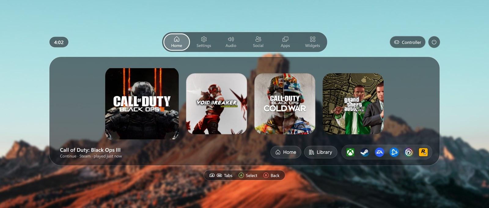
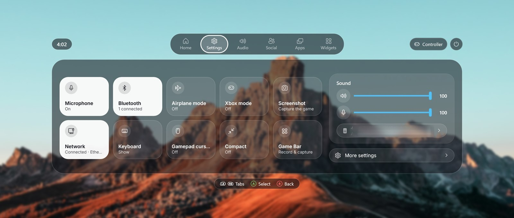
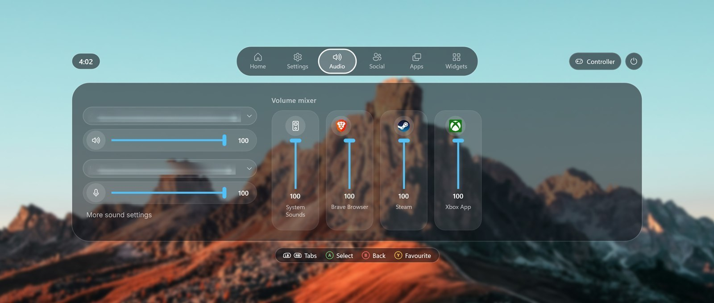
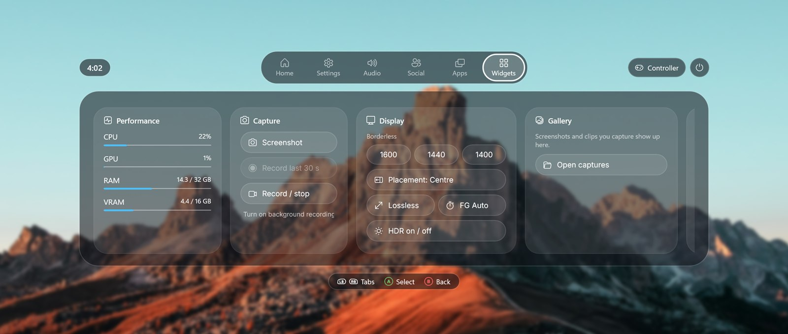

<p align="center">
  
</p>

<p align="center">
  <a href="https://github.com/ykyritsis/Nexus/releases/latest"></a>
  
  
  
  
</p>

<p align="center">
  <b>A console-style Guide button overlay for Windows.</b><br>
  Everything Xbox Game Bar does, rebuilt to feel like a console: press <kbd>Guide</kbd> in any game,<br>
  the game blurs behind a glass panel, and the controller drives everything.
</p>

<p align="center">
  
</p>

---

## Highlights

| | |
|---|---|
|  **Guide opens it, instantly** | Pre-warmed at startup; a press only shows it (~30 ms). Holding Guide is left to Windows' task view. |
|  **Live glass over your game** | The game keeps moving behind a soft blur: its own window is captured and re-blurred on the GPU, up to 60 fps. |
|  **HDR-correct** | Captured in 16-bit scRGB and levelled to your SDR white, so the background matches the game's brightness without bloom. |
|  **Pauses the game, like a console** | Opening the guide taps Start for the game (unless you pressed Start in the last 5 s). |
|  **Games ignore the controller in the guide** | A virtual-controller bridge (HidHide + ViGEmBus, set up with one press) means no game sees your input while the guide is open. Nothing is injected into games. |
|  **Made for a controller** | A focus ring that glides between items, remembers where you were, slides tabs the way you pressed, and centres lists. |
|  **Featherweight** | 0% CPU and a few MB of memory while closed; every timer and lookup runs only while its tab is open. |
|  **Updates itself** | Checks GitHub 30 s after start and every 6 h, downloads with progress (~90 MB in seconds) and installs between games. |

## Screenshots

<table>
  <tr>
    <td width="50%"><br><sub><b>Settings</b>: Control Center tiles, volume, output device</sub></td>
    <td width="50%"><br><sub><b>Audio</b>: devices and a per-app mixer</sub></td>
  </tr>
  <tr>
    <td width="50%"><br><sub><b>Widgets</b>: performance, capture, display, gallery</sub></td>
    <td width="50%"><br><sub><b>Home</b>: your recent games, launchers</sub></td>
  </tr>
</table>

<sub>Captured with Nexus's own HDR-correct screenshot (click both sticks, or F12, while it's open).</sub>

## What's inside

| Tab | |
|---|---|
| **Home** | While a game runs: **Now playing** with its art, session and total playtime, Steam achievement progress, and Resume / Screenshot / Record last 30 s / Steam page / Quit game. Otherwise your last four games as square tiles (scenic art with the logo centred; Steam, Xbox, PlayStation and IGN art) plus launchers. |
| **Settings** | Control Center tiles: mic, Bluetooth, airplane mode, Xbox mode, screenshot, network, touch keyboard, gamepad cursor, compact mode, Game Bar; volume and mic; More settings (overlay size, startup, controller pop-ups, updates, setup). |
| **Audio** | Output and input device, levels and mute; a per-app mixer as channel strips with favourites. |
| **Social** | Steam friends with online and in-game status (no API key, no sign-in); chat and profile. |
| **Apps** | Open apps with live thumbnails; switch, close (X), end a frozen app (Y twice). |
| **Widgets** | Performance (CPU, GPU, RAM, VRAM), Capture, Display (borderless sizes, Lossless Scaling, HDR), Gallery, Resources. |

In the corner: a **controller** chip (battery, rumble test, pairing, input lock) and a **power** menu.
Controller pop-ups tell you when a pad connects, disconnects or runs low, without stealing focus.

## Get started

1. Download **`Nexus-win-x64.zip`** from the [latest release](https://github.com/ykyritsis/Nexus/releases/latest) and extract it somewhere you can write to, e.g. `%LOCALAPPDATA%\Programs\Nexus`.
2. Run `Nexus.exe` and press **Guide**. The first time, **Set up Nexus** walks you through everything, each item with its live state and a one-press fix:
   - Windows Game Bar and Steam let go of the Guide button
   - Games ignore the controller while the guide is open (installs two small signed drivers, one admin prompt)
   - Start with Windows
   - Pause the game when the guide opens
3. That's it. Come back to setup any time from **More settings → Run setup**.

## Controls

| Controller | | Keyboard |
|---|---|---|
| <kbd>Guide</kbd> | Open / close | <kbd>Win</kbd> + <kbd>Shift</kbd> + <kbd>G</kbd> |
| D-pad / left stick | Move | Tab |
| <kbd>A</kbd> | Select (the hint bar says what it does: Play, Toggle, …) | Enter / Space |
| <kbd>B</kbd> | Back / close | Esc |
| <kbd>LB</kbd> <kbd>RB</kbd> | Previous / next tab | |
| <kbd>X</kbd> <kbd>Y</kbd> | Page actions (shown in the hint bar) | |
| <kbd>LS</kbd> + <kbd>RS</kbd> (click both) | HDR-correct screenshot of the screen, overlay included | <kbd>F12</kbd> |

Command line: `Nexus.exe --toggle`, `--background`, `--quit`, `--test-toast`.

## Privacy and anti-cheat

- **No accounts, no sign-ins, no telemetry.** Everything is read locally (Steam's own files, Windows APIs); network calls are game art lookups, Steam friends' public status and the update check.
- **Nothing touches the game.** No injection, no hooks, no memory reads. Nexus is an always-on-top window; the background comes from Windows' official screen capture.
- **The input lock** uses a virtual Xbox controller, the same way DS4Windows does. A few anti-cheats refuse virtual controllers (Valorant, League of Legends): Nexus pauses the lock while those run.
- Exclusive fullscreen games can't be drawn over safely; use borderless.

## How it's built

- **C# / .NET 9, WinUI 3** (Windows App SDK 1.8, unpackaged, self-contained) with **Win2D** for the GPU blur and the **Inter** typeface.
- **Guide button:** XInput's `XInputGetStateEx` (ordinal 100), polled on its own thread (`Input/GamepadService.cs`).
- **Glass:** a transparent window; a still frame then a live, GPU-blurred capture of the game sits behind a smoked-glass panel (`Views/HdrBackdrop.cs`), with a compositor-driven focus ring (`Views/ShellWindow.xaml.cs`).
- **Input lock:** `Services/InputBridge.cs` hides the real pad with HidHide and mirrors it to a ViGEmBus Xbox 360 pad at ~1 kHz, idling it while the guide is open.
- **Updates:** GitHub Actions builds every push to `main` into a release; `Services/Updater.cs` picks it up.

### Build it

Needs the .NET 9 SDK; the Windows App SDK comes from NuGet.

```
dotnet build src/Nexus/Nexus.csproj -c Release -p:Platform=x64
```

Output: `src/Nexus/bin/x64/Release/net9.0-windows10.0.22621.0/win-x64/Nexus.exe`. Builds run from the source tree don't update themselves.

## Credits

[HidHide](https://github.com/nefarius/HidHide) and [ViGEmBus](https://github.com/nefarius/ViGEmBus) by Nefarius Software Solutions ·
[Inter](https://rsms.me/inter/) by Rasmus Andersson (OFL) · [Win2D](https://github.com/microsoft/Win2D) and the Windows App SDK by Microsoft ·
[NAudio](https://github.com/naudio/NAudio) by Mark Heath ·
[Fluent UI System Icons](https://github.com/microsoft/fluentui-system-icons) by Microsoft (MIT).
